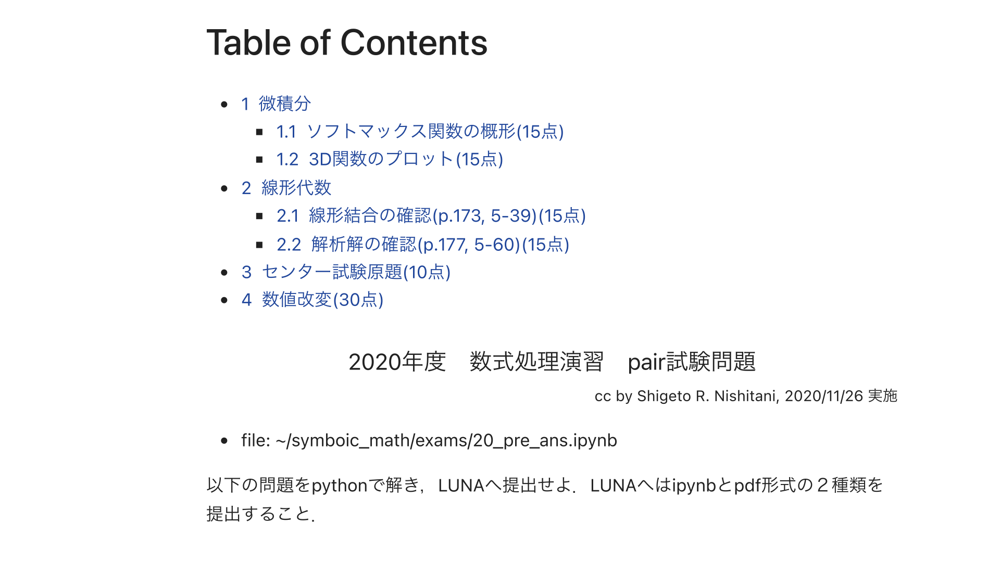

#+OPTIONS: ^:{}
#+STARTUP: indent nolineimages overview num
#+TITLE: d1_0922 initial
#+AUTHOR: Shigeto R. Nishitani
#+EMAIL:     (concat "shigeto_nishitani@mac.com")
#+LANGUAGE:  jp
#+OPTIONS:   H:4 toc:t num:2
#+HTML_HEAD: <link rel="stylesheet" type="text/css" href=".style_w_link_button.css" />
#+MACRO: dummy_link @@html:<a href="#">$1</a>@@

# for style.css, never move from here
[[../d0_anounce/readme.html][prev_button]]
[[../canvas.html][up_button]]
[[../d2_log/readme.html][next_button]]
# for a real link rewrite usual [[\url][]]

| 

| date          | 参考資料                  | 宿題       |
|---------------+---------------------------+------------|
| d1_0925_intro | [[file:pair_agreement.docx][ペア同意書]]                |            |
|               | [[https://kwanseio365-my.sharepoint.com/:b:/g/personal/cru32369_kwansei_ac_jp/ETMXnjOHKZtNvRx1i4eYFKoByg9nVEzABi2xbEQSbhxbgA?e=d28wk9][c1_install]] [[https://kwanseio365-my.sharepoint.com/:b:/g/personal/cru32369_kwansei_ac_jp/EUASKW9Xlx1JhzB8gytVmzEBJpc2xJ97dasYydlVwIR6Zw?e=Lfhxle][c2_python]]      |            |
|               | [[file:20_pair.ipynb][20年度ペア試験]] ( [[https://nbviewer.org/github/daddygongon/jupyter_num_calc/blob/main/symbolic_math/./group_works/20_pair.ipynb][viewer]] ) | [[https://nbviewer.org/github/daddygongon/jupyter_num_calc/blob/main/symbolic_math/./ipynb_txt/first_leaf.ipynb][first_leaf]] |

* 宿題
- python, jupyter notebookをBYODにinstall 
- 「ペア同意書」は来週提出してください．
- 来週までにfirst_leafをやってきてください．
  - 提出は来週の課題とともに1チーム一つです．

* jupyter notebookの新設定
** table of contents
原因はほぼ判明しました．

- 新しいAnaconda：Notebook 7.5.7，JupyterLab 4.5.9
- 古いAnaconda：Notebook 6.5.2
- 旧設定には=toc2/main: true=が残っている
- しかし，旧=toc2=拡張本体は新環境に存在しない

Notebook
7では旧=toc2=を再インストールする必要はありません．目次は標準機能として組み込まれています．一方，Notebook
6用の拡張機能はNotebook
7とは互換性がありません．[[https://jupyter-notebook.readthedocs.io/en/v7.5.1/migrating/frontend-extensions.html][Notebook 7公式説明]]

まず，ノートブックを開いた状態で次を試してください．

1. 上部メニューの=View=を開く．
2. =Show Left Sidebar=があれば選択する．
3. =Table of Contents=を選択する．

または，=Control + Shift + K=で目次パネルを直接開けます．目次はNotebook
7で標準搭載され，通常は左サイドバーに表示されます．[[https://jupyter-notebook.readthedocs.io/en/v7.0.0/notebook_7_features.html][Jupyter公式説明]]

なお，現在は新旧2つのAnacondaが残っています．

- 新：=/opt/anaconda3=
- 旧：=/Users/bob/anaconda3=

今後の環境混在を避けるため，どちらからJupyterを起動しているかは意識した方がよさそうです．まずは=View=メニューに=Table of Contents=があるか確認してください．
