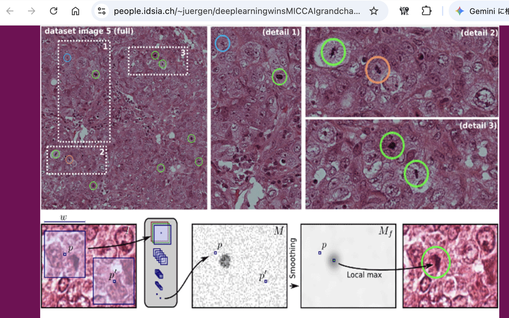

#+OPTIONS: ^:{}
#+STARTUP: indent nolineimages overview num
#+TITLE: d4_1013:線形代数LA_numpy(Breast Cancer Detect)
#+AUTHOR: Shigeto R. Nishitani
#+EMAIL:     (concat "shigeto_nishitani@mac.com")
#+LANGUAGE:  jp
#+OPTIONS:   H:4 toc:t num:2
#+HTML_HEAD: <link rel="stylesheet" type="text/css" href=".style_w_link_button.css" />
#+MACRO: dummy_link @@html:<a href="#">$1</a>@@

# for style.css, never move from here
[[../d3_diff_int/readme.html][prev_button]]
[[../canvas.html][up_button]]
[[../d5_la_basic/readme.html][next_button]]
# for a real link rewrite usual [[\url][]]

* 今週提出課題
| 
| がん細胞の顕微鏡写真.

線形代数の応用として，乳がんの自動検出器を作成してもらいます．
AI的には古いアプローチですが，何をしているのかが直感的なので，
ぜひ理解に努めてください．
|                | ipynb                      | github |
|----------------+----------------------------+--------|
| 今週提出の宿題 | [[file:linear_algebra_scipy.ipynb][linear_algebra_scipy.ipynb]] | [[https://github.com/daddygongon/symbolic_math_public/blob/main/d4_la_breast_cancer/linear_algebra_scipy.ipynb][github]] |
|----------------+----------------------------+--------|
| 今週提出の課題 | [[file:gw3_ex.ipynb][gw3_ex.ipynb]]               | [[https://github.com/daddygongon/symbolic_math_public/blob/main/d4_la_breast_cancer/gw3_ex.ipynb][github]] |
| 補足資料1      | [[file:gw3_breast_cancer.ipynb][gw3_breast_cancer.ipynb]]    | [[https://github.com/daddygongon/symbolic_math_public/blob/main/d4_la_breast_cancer/gw3_breast_cancer.ipynb][github]] |
| 補足資料2      | [[file:python_files_and_dir.ipynb][ファイル操作]]               | [[https://github.com/daddygongon/symbolic_math_public/blob/main/d4_la_breast_cancer/python_files_and_dir.ipynb][github]] |
| 解答例　       | [[file:gw3_ex_ans.ipynb][gw3_ex_ans.ipynb]]           | [[https://github.com/daddygongon/symbolic_math_public/blob/main/d4_la_breast_cancer/gw3_ex_ans.ipynb][github]] |

以下のdataをipynbの実行ファイルをdirectoryの下にwdbc_dataに
おいて課題を進めてください．
- data ::  [[file:wdbc_data/train_A.data][train_A.data]], [[file:wdbc_data/train_b.data][train_b.data]], [[file:wdbc_data/validate_A.data][validate_A.data]], [[file:wdbc_data/validate_b.data][validate_b.data]] 

* 次週提出宿題
| （次週提出の)宿題 | [[https://github.com/daddygongon/symbolic_math_public/blob/main/d5_la_basic/linear_algebra_sympy.ipynb][github/linear_algebra_sympy.ipynb]] |
|                   | [[https://github.com/daddygongon/symbolic_math_public/blob/main/d5_la_basic/four_spaces_qr.ipynb][github/four_spaces_qr.ipynb]]       |

- [[https://kwanseio365-my.sharepoint.com/:b:/g/personal/cru32369_kwansei_ac_jp/IQCOB6Hl1QqUSqtKEtfjXRzjAfKLLc5bwzuH5RUKrHLTwKE?e=Uci1tX][行列の４基本部分空間(Strang21_four_basic_subspaces.pdf)]]

