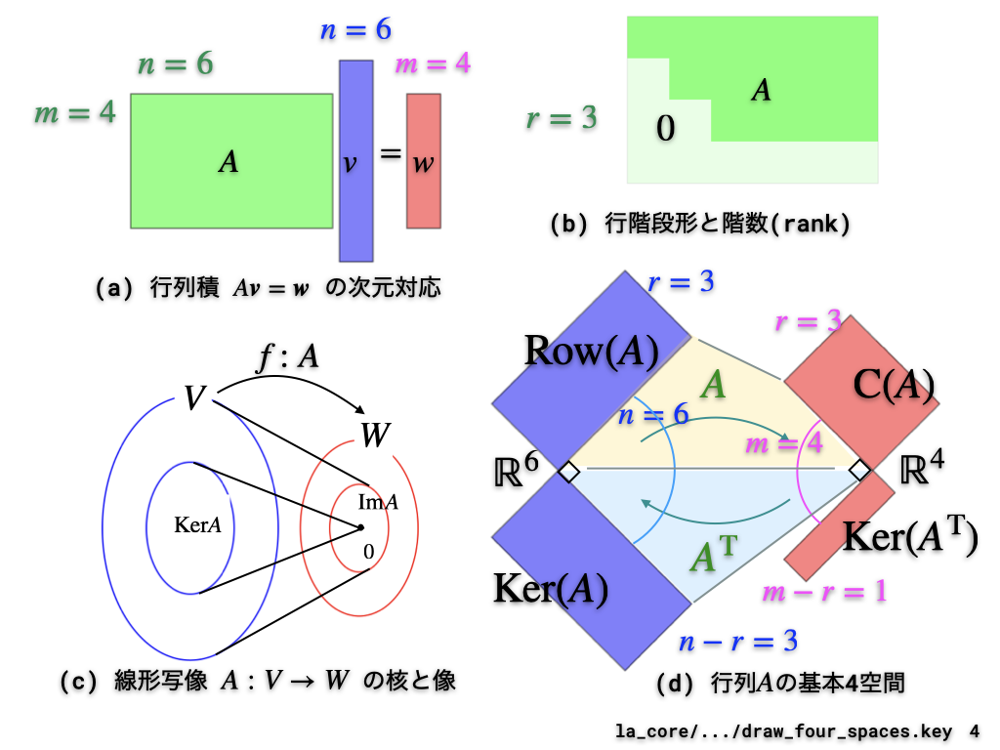
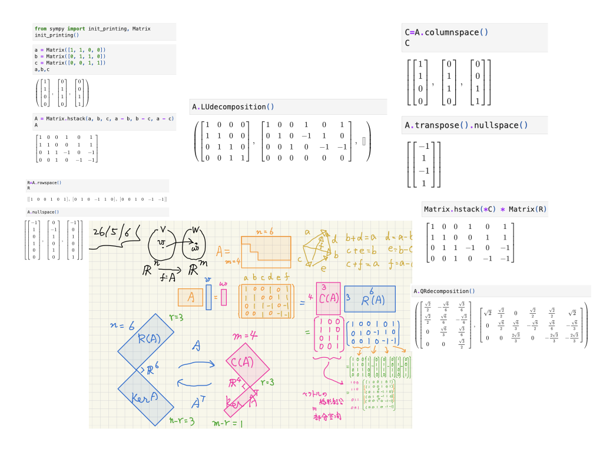

#+OPTIONS: ^:{}
#+STARTUP: indent nolineimages overview num
#+TITLE: d5_1020:線形代数LA_sympy (QR vs SVD)
#+AUTHOR: Shigeto R. Nishitani
#+EMAIL:     (concat "shigeto_nishitani@mac.com")
#+LANGUAGE:  jp
#+OPTIONS:   H:4 toc:t num:2
#+HTML_HEAD: <link rel="stylesheet" type="text/css" href=".style_w_link_button.css" />
#+MACRO: dummy_link @@html:<a href="#">$1</a>@@

# for style.css, never move from here
[[../d4_la_breast_cancer/readme.html][prev_button]]
[[../canvas.html][up_button]]
[[../d6_eq_manip/readme.html][next_button]]
# for a real link rewrite usual [[\url][]]

* 線形代数のイメージ
|  | 

線形代数の計算を提供するpackageはnumpyだけでなく，
sympyもあります．
こちらの方が見た目を綺麗にできるので，
ちょっとした数学的な事柄を理解するのに重宝します．
これを使って行列のshape, 基本４空間，QR分解によるフィッティングを
理解してもらいます．
* 今週提出の課題
|--------------+-----------------------------------+--------|
| 先週の宿題   | [[file:./linear_algebra_sympy.ipynb]] | [[https://github.com/daddygongon/symbolic_math_public/blob/main/d5_la_basic/linear_algebra_sympy.ipynb][github]] |
| 先週の宿題   | [[file:./four_spaces_qr.ipynb]]       | [[https://github.com/daddygongon/symbolic_math_public/blob/main/d5_la_basic/four_spaces_qr.ipynb][github]] |
|--------------+-----------------------------------+--------|
| グループ課題 | gw4_svd_vs_qr.ipynb               |        |
| 解答例       | gw4_svd_vs_qr_ans.ipynb           |        |

# | グループ課題      | [[gw4_page_rank.ipynb]]                  | [[https://github.com/daddygongon/jupyter_num_calc/blob/main/symbolic_math/group_works/gw4_page_rank.ipynb][github]] |
# | 補足資料          | [[gw4_pagerank_eigenvect_correct.ipynb]] | [[https://github.com/daddygongon/jupyter_num_calc/blob/main/symbolic_math/group_works/gw4_pagerank_eigenvect_correct.ipynb][github]] |

* 次週提出宿題
| （次週提出の)宿題 | [[file:equation_manipulation.ipynb]]  | [[https://github.com/daddygongon/symbolic_math_public/blob/main/d5_la_basic/equation_manipulation.ipynb][github]] |

参考資料
- [[https://kwanseio365-my.sharepoint.com/:b:/g/personal/cru32369_kwansei_ac_jp/IQCOB6Hl1QqUSqtKEtfjXRzjAfKLLc5bwzuH5RUKrHLTwKE?e=Uci1tX][行列の４基本部分空間(Strang21_four_basic_subspaces.pdf)]]
- [[https://kwanseio365-my.sharepoint.com/:b:/g/personal/cru32369_kwansei_ac_jp/IQDguVW_LQ4ISrubHvGqRx9JAVQ_UpqEeh753Kx-yn5se4g?e=iag40I][主成分分析の解説(Strang21_principal_comp_ana.pdf)]]

